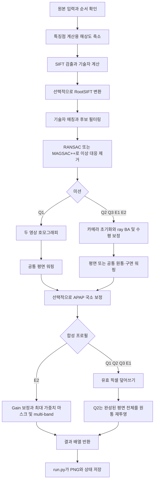

# 이미지 정합 프로젝트 통합 정리

작성 기준: **2026-11-24**, 프로젝트 경로: `/home/jungejblue/IS_ws`

이 문서는 과제 요구사항, 구현 변경 과정, Q1~E2 실행 흐름, 비교 방법론, 저장된 결과 이미지, 평가 지표, 외부 벤치마크, 프로젝트 결과 PNG 평가를 한곳에 정리한다. 수치는 현재 보존된 JSON·CSV 실험 기록에서 가져왔다. 초기 탐색 실험은 대화에서 확인되는 진행 이력으로 구분하고, 보존되지 않은 결과에 새로운 점수나 순위를 부여하지 않았다.

> **가장 중요한 구분**
>
> - 과제 결과: baseline 5개 + 개선 방법 4개 × 5개 미션 = **PNG 25개**.
> - 사용자가 요청한 개선 결과: baseline을 제외한 **PNG 20개**.
> - 외부 벤치마크: HPatches 580쌍 + UDIS-D 1,105쌍에 5개 방법을 적용한 **8,425회 평가**.
> - 프로젝트 최종 이미지 평가: 저장된 **20개 PNG를 직접 읽어**, 원본 사진과 공통 좌표에서 비교한 별도 평가.
> - 외부 벤치마크 점수, 후처리 전 겹침 점수, 최종 PNG 원본 일치도는 서로 다른 실험이다.

## 목차

1. [과제 목표와 제약](#01-task)
2. [프로젝트 진행 과정](#02-history)
3. [디렉터리와 핵심 파일](#03-files)
4. [실행 흐름과 미션별 처리](#04-pipeline)
5. [평면·원통·구면 투영과 초기 실험](#05-projection)
6. [Baseline 및 네 가지 개선 방법](#06-methods)
7. [후처리와 블렌딩 조건](#07-blending)
8. [생성 결과와 이미지 모음](#08-results)
9. [평가 지표의 정의](#09-metrics)
10. [벤치마크 선택과 실제 평가 조건](#10-benchmarks)
11. [외부 벤치마크 결과](#11-benchmark-results)
12. [프로젝트 후처리 전 겹침 영역 평가](#12-overlap)
13. [저장된 최종 PNG 20개 평가](#13-final-png)
14. [결과 해석과 한계](#14-discussion)
15. [실행·재현 방법과 검증](#15-reproduce)
16. [발표 구성과 남은 작업](#16-presentation)
17. [조사한 방법·저장소·출처](#17-references)

<a id="01-task"></a>

## 1. 과제 목표와 제약

과제는 서로 겹치는 여러 사진을 하나의 파노라마로 정합하는 것이다. 안내 원문은 [이미지스티칭 프로젝트 안내 PDF](assignment/이미지스티칭_프로젝트_안내.pdf)에 있다.

| 미션 | 입력 | 요구 투영 | 설명 |
|---|---|---|---|
| Q1 | 제공 사진 2장 | 평면 | 특징점 추출 → 매칭 → 두 영상 정합 |
| Q2 | 제공 사진 3장 | 원통 | 정합 후 재투영으로 넓은 장면의 왜곡 완화 |
| Q3 | 직접 촬영 사진 8장 | 원통 | 2×4 격자 입력 전체를 사용하는 정합 |
| E1 | Q3와 같은 8장 | 구면 | 원통과 다른 투영 표현 비교 |
| E2 | Q3와 같은 8장 | 구면 + 블렌딩 | 밝기 경계와 합성 이음선 완화 |

Q3 촬영 안내는 이웃 사진 사이 20~30% 중첩을 두고, 아래 순서로 입력하는 것이다. 이 비율은 과제의 촬영 지침이며, 현재 사진의 실제 중첩률 측정값은 아니다.

```text
1  2  3  4
5  6  7  8
```

현재 보존된 원본 입력의 해상도는 다음과 같다.

| 입력 세트 | 파일·장수 | 원본 해상도(가로×세로) |
|---|---|---|
| Q1 | `Q1_img_1.jpg`, `Q1_img_2.jpg` | 873×580, 1035×580 |
| Q2 | `Q2_img_1.JPG` ~ `Q2_img_3.JPG` | 각 2000×1329 |
| Q3/E1/E2 | `Q3_img_1.jpeg` ~ `Q3_img_8.jpeg` | 각 1400×1050 |

제약은 다음과 같다.

- 제출 알고리즘은 `stitching.py` 하나에 작성한다. 직접 만든 다른 Python 파일을 제출 코드에서 import하지 않는다.
- `q1(img_paths)`, `q2(img_paths)`, `q3(img_paths)`, `e1(img_paths)`, `e2(img_paths)`의 인터페이스를 유지한다.
- 입력은 전달받은 `img_paths`로 읽는다. 반환값은 OpenCV 형식의 결과 이미지 배열이다.
- 제공 실행기 `run.py`는 수정하지 않는다. 저장은 실행기가 담당한다.
- 컴퓨터비전 라이브러리는 OpenCV만 사용한다. NumPy, Matplotlib, 경로·파일 처리용 표준 라이브러리는 허용된다.
- `cv2.Stitcher`와 `cv2.Stitcher_create`는 사용하지 않는다. 단계별 구현과 설명이 필요하다.
- Q3는 팀이 직접 촬영한 8장을 사용하고 다른 팀과 공유하지 않는다.

현재 `experiments/`의 파일들은 실험 실행·평가·보고서 생성을 위한 보조 도구다. 제출용 `stitching.py`가 이 파일들을 import하는 구조가 아니다.

안내문에 적힌 제출 구성은 `stitching.py`, 직접 촬영한 `data/Q3/`, 발표 파일이다. `run.py`, 제공 `data/Q1·Q2`, `results/`는 제출 대상에서 제외한다. 안내문에는 팀 제출 11/30 23:59, 발표 및 개인 동료평가 12/1이 기재되어 있다. 이는 제공 PDF의 기록이며 이후 공지 변경 여부는 이 문서에서 확인하지 않았다.

<a id="02-history"></a>

## 2. 프로젝트 진행 과정

| 단계 | 진행한 작업·문제의식 | 결정 또는 결과 |
|---|---|---|
| 1 | 프로젝트 디렉터리·실행기·안내 PDF 분석 | Q1~E2의 입력·투영·제출 제약 파악 |
| 2 | 초기 Q1·Q2 결과와 원본 비교 | 특징점·매칭·변환 추정과 이음선 문제를 분리해서 검토 |
| 3 | Q2 개선 및 재실행 | 카메라 추정, 공통 좌표계 정합, 원통 재투영 경로 정비 |
| 4 | “개별 원통 영상의 중첩”과 “하나의 평면 합성 후 원통 재투영” 구분 | Q2를 **평면 파노라마 한 장 완성 → 전체를 한 번 원통 재투영**하는 방식으로 정리 |
| 5 | 볼록·오목하게 보이는 원통 표현 비교 | `Q2_concave_experiment.png` 등 탐색 결과를 놓고 자연스러움 논의 |
| 6 | Q3·E1·E2로 확장 | 8장 원통, 8장 구면, 구면 후처리 결과 생성 |
| 7 | Q3 사진 교체 | 새 8장으로 Q3·E1·E2 재실행; 이전 입력의 결과를 최종 평가에 혼용하지 않음 |
| 8 | 새 Q3의 넓은 촬영 범위 확인 | 당시 약 259°로 추정된 범위를 한 전방 평면에 담기 어렵다고 판단; 사용자가 **8장 전체 공통 원통 정합** 선택 |
| 9 | 블렌딩 유무 비교 요청 | 당시 결과에 `_blending`을 붙이는 구분과 후처리 없는 결과 생성 진행; 블렌딩에 노출·이음선 처리가 포함되는지 정리 |
| 10 | 결과 폴더 재구성 및 발표 비교 실험 설계 | Brown–Lowe 기반 baseline, 지표·벤치마크·개선 방법 조사 |
| 11 | 과제용 후처리 기준 확정 | **Q1·Q2·Q3·E1은 후처리 없음, E2만 노출 보정·블렌딩** |
| 12 | OpenCV 제약에 맞춘 네 방법 구현 | RootSIFT, MAGSAC++, 결합, 결합+APAP; 총 20개 PNG 생성 |
| 13 | 작업 폴더 이름 임시 변경에 따른 경로 문제 정리 | 다시 `IS_ws`를 기준으로 입력·코드·결과 기록 확인 |
| 14 | 외부 벤치마크 실행 | HPatches/UDIS-D에 baseline 포함 5개 방법 적용 |
| 15 | “벤치마크가 내 20개 결과를 채점한 것인가?” 확인 | 외부 데이터 평가와 자체 사진 평가가 다름을 명확히 구분 |
| 16 | 최종 PNG 20개 직접 평가 | 저장 PNG에서 원본 좌표로 복원하여 공통 영역 PSNR·SSIM 계산 |

초기 오목·볼록 실험과 `_blending` 파일은 이후 결과 폴더 재구성 이전의 이력이다. 현재 보존된 최종 실험 폴더에 없는 과거 파일의 정확한 화질 순위·수치·코드 상태는 재검증할 수 없다. “오목이 언제나 우수하다” 또는 “볼록이 항상 정답이다”라는 결론을 최종 실험 결과로 기록하지 않는다. 약 259° 역시 당시 추정 기록이며, 보정된 카메라로 측정한 확정 시야각이 아니다.

<a id="03-files"></a>

## 3. 디렉터리와 핵심 파일

```text
IS_ws/
├─ README.md                          # 설치·실행·협업 안내
├─ stitching.py                       # 제출용 알고리즘 구현
├─ run.py                             # 제공 실행기, 수정 금지
├─ requirements.txt                   # 프로젝트 의존성
├─ docs/
│  ├─ PROJECT_REPORT.md               # 현재 통합 문서
│  ├─ assignment/                     # 과제 공지 PDF
│  └─ research/stitching_comparison.html # 초기 조사·실험 설계 기록
├─ data/
│  ├─ Q1/                             # 제공 2장
│  ├─ Q2/                             # 제공 3장
│  ├─ Q3/                             # 현재 직접 촬영 8장
│  └─ benchmarks/                     # HPatches·UDIS-D 원본/압축파일/출처
├─ experiments/
│  ├─ run_brown_lowe.py
│  ├─ run_methods.py
│  ├─ download_benchmarks.py
│  ├─ evaluate_benchmarks.py
│  ├─ evaluate_missions.py
│  ├─ report_evaluation.py
│  ├─ evaluate_project_results.py
│  ├─ plot_project_scores.py
│  └─ snapshots/                      # 방법별 동결 실행 소스
├─ scripts/                           # 환경·저장소 확인, 데이터 압축 해제
├─ third_party/                       # 공식 안내·참조 코드 서브모듈
│  ├─ hpatches-dataset/
│  ├─ udis-d/
│  └─ udis2/
└─ results/                           # 로컬 산출물, Git 제외
   ├─ brown+lowe/                     # baseline 5개 PNG
   ├─ RootSIFT/                       # 개선 방법별 5개 PNG
   ├─ MAGSAC++/
   ├─ RootSIFT+MAGSAC++/
   ├─ RootSIFT+MAGSAC+++APAP/
   ├─ comparison.html                # 개선 방법 20개 결과 갤러리
   ├─ evaluation/                    # 외부 벤치마크 + 후처리 전 진단
   └─ project_evaluation/            # 최종 PNG 20개 직접 평가
```

| 파일·폴더 | 역할 |
|---|---|
| [stitching.py](../stitching.py) | 특징점, 매칭, 강건 추정, BA, 워핑, APAP, 합성, 다섯 미션 함수 |
| [run.py](../run.py) | 입력 파일 자연순 정렬 → 해당 함수 호출 → 결과 PNG와 status JSON 저장 |
| [run_brown_lowe.py](../experiments/run_brown_lowe.py) | 과제용 baseline 프로필을 적용하고 스냅샷·해시·결과 저장 |
| [run_methods.py](../experiments/run_methods.py) | 네 개선 방법 × 다섯 미션 실행, 갤러리와 실험 메타데이터 저장 |
| 각 방법의 `stitching_snapshot.py` | 결과 생성 당시 코드와 선택된 설정을 고정한 재현용 파일 |
| 각 방법의 `experiment.json` | 환경, 설정, 입력·코드·출력 해시, 크기, 실행 시간, 진단값 |
| 각 방법의 `*_run.log`, `*_status.json` | 단계별 로그와 실행 성공 여부 |
| [evaluate_benchmarks.py](../experiments/evaluate_benchmarks.py) | 외부 영상 쌍에 저장된 Q1 경로 실행, 정답 기하·광도 점수 산출 |
| [evaluate_missions.py](../experiments/evaluate_missions.py) | 프로젝트 25개 실행의 후처리 전 입력 간 중첩 비교 |
| [evaluate_project_results.py](../experiments/evaluate_project_results.py) | 최종 PNG 20개를 원본 좌표로 복원하여 원본 일치도 측정 |
| [report_evaluation.py](../experiments/report_evaluation.py) | 외부 벤치마크 및 후처리 전 진단의 CSV·HTML·그래프 생성 |
| [plot_project_scores.py](../experiments/plot_project_scores.py) | 최종 PNG 점수를 발표용 PNG·PDF 그래프로 변환 |

**주의:** 현재 루트 `stitching.py`의 기본값은 `ALGORITHM="brown_lowe"`, `BASELINE_PROFILE=None`이다. 이것을 기본 실행하는 것과, 저장된 `brown_lowe_assignment` 프로필의 스냅샷을 실행하는 것은 후처리 조건이 같지 않을 수 있다. 아래 결과를 재현할 때는 해당 폴더의 스냅샷을 사용한다. 코드 맨 위의 일반 설명보다 실제 프로필 분기와 실험 메타데이터를 기준으로 해석한다.

<a id="04-pipeline"></a>

## 4. 특징점 추출부터 결과 저장까지



이 흐름에서 특징 추출용 축소와 최종 출력 해상도는 다르다. 특징점은 최대 약 1메가픽셀에서 처리하고, 변환은 실제 축소 비율을 반영해 원본 좌표로 복원한다.

### 4.1 특징점과 매칭

SIFT는 위치·크기·방향이 다른 사진 사이에서 대응 가능한 국소 특징을 찾고 기술자를 만든다. 기본 최대 특징점 수는 6,000개다. RootSIFT 실험은 검출기 자체를 바꾸지 않고 기술자 표현을 바꾼다.

Q1은 BFMatcher의 L2 거리로 가까운 두 후보를 찾고, 첫 번째 후보가 두 번째보다 충분히 가까운 경우만 남기는 ratio test를 사용한다. 비율은 0.75다. 최소 유효 inlier 수는 10이다.

Q2 이후에는 OpenCV detail matcher가 후보를 만든다. Q3/E1/E2는 알려진 2×4 배치의 이웃 관계를 사용하며, 구현상 대각선 이웃도 포함한다. 연결 그래프가 충분하지 않으면 일부 사진만 선택해 성공으로 처리하지 않고 실패를 보고한다.

### 4.2 강건 추정

잘못 연결된 특징점이 남아 있으면 변환 전체가 틀어질 수 있다. RANSAC 또는 MAGSAC++로 변환과 일치하는 대응점들을 선택한다.

Q1은 `cv2.findHomography`를 직접 호출한다. MAGSAC 계열의 다중영상 경로는 detail matcher가 제공한 후보 전체에서 H와 inlier를 다시 추정하고, 그 inlier를 후속 BA와 APAP에 전달한다. 이름만 바꾸고 이전 RANSAC의 inlier를 그대로 사용하는 비교가 아니다.

### 4.3 카메라 추정과 bundle adjustment

Q2 이후에는 쌍별 관계에서 카메라 초점거리와 회전을 초기화하고, 여러 사진의 대응 광선이 일치하도록 전체 변수를 함께 조정한다. 이 단계가 ray bundle adjustment, 즉 ray BA다. 이후 wave correction과 기준 방향 보정으로 파노라마의 전체 기울기를 정리한다.

baseline은 OpenCV ray BA를 사용한다. 네 개선 방법은 MAGSAC++가 새로 고른 inlier를 확실히 전달하기 위해 NumPy로 구현한 유한차분 Jacobian 기반 LM 최적화를 사용한다. 초점거리는 로그 변수로 표현하고 첫 카메라의 회전을 고정하여 전체 회전의 불확정성을 제거한다.

로그의 BA fitting RMS는 최적화에 사용한 대응점의 잔차다. 독립적인 정답 정확도가 아니다.

### 4.4 미션별 최종 경로

| 미션 | 현재 저장된 비교 실험의 실제 경로 |
|---|---|
| Q1 | 2장 → 특징·매칭 → H → 첫 영상 기준 평면 워핑 → 선택적 APAP → 덮어쓰기 |
| Q2 | 3장 → 카메라·BA → 공통 평면 워핑 → 선택적 APAP → 평면 한 장 합성 → 전체 원통 재투영 |
| Q3 | 현재 8장 → 카메라·BA → 공통 원통 좌표계 워핑 → 선택적 APAP → 덮어쓰기 |
| E1 | 같은 8장 → 카메라·BA → 공통 구면 좌표계 워핑 → 선택적 APAP → 덮어쓰기 |
| E2 | E1과 같은 기하 경로 → 선택적 APAP → 영상별 gain 보정 → 최대 가중치 마스크 → multi-band |

일반 코드에는 평면으로 처리 가능한 Q3와 평행이동에 가까운 입력을 위한 다른 분기도 존재한다. 현재 보존된 과제 비교 프로필과 현재 넓은 Q3 사진의 경로는 위 표를 따른다.

<a id="05-projection"></a>

## 5. 평면·원통·구면 투영과 오목·볼록 논의

### 5.1 평면 정합

평면 호모그래피는 동차좌표에서 `p' ~ H p`로 표현된다. 좁은 시야나 하나의 평면으로 설명하기 좋은 입력에 적합하다. 촬영 범위가 커지면 전방 평면의 지평선 부근에서 좌표가 크게 늘어나거나 무한대로 발산할 수 있다.

### 5.2 Q2의 단일 원통 재투영

현재 Q2는 개별 입력을 서로 다른 원통에 만든 뒤 겹치는 방식이 아니다. 먼저 하나의 공통 평면 파노라마를 만들고, 그 전체를 같은 초점거리와 원점을 갖는 원통 좌표로 바꾼다.

평면 좌표가 `(x,y)`, 투영 축척이 `f`라면 사용한 정방향 식은 다음과 같다.

```text
θ = atan(x / f)
u = f θ
v = y / sqrt(1 + (x/f)²)
```

실제 픽셀 생성에는 구멍을 줄이기 위해 역방향 좌표 `(u,v) → (x,y)`를 계산하고 `cv2.remap`으로 샘플링한다. 결과의 광축 원점은 배열의 임의 중앙이 아니라 앞선 평면 투영의 좌표계를 유지한다.

### 5.3 현재 Q3에서 공통 원통이 필요한 이유

새 Q3 입력은 한 전방 평면의 유효 범위를 넘어선다. 그래서 8장을 하나의 평면으로 강제로 펼친 뒤 다시 투영하는 대신, 추정된 카메라 관계를 이용해 **동일한 하나의 원통 좌표계**에 각 입력을 워핑한다.

사진마다 워핑 연산을 호출하더라도 서로 독립적인 원통을 만드는 것은 아니다. 공통 투영 축척·축·카메라 관계를 사용하여 같은 좌표계에 놓는 것이다. 이 방식은 사용자가 넓은 장면 전체 보존을 선택한 이후 적용되었다. 과제의 일반적인 “정합 후 재투영” 도식과 현재 초광각 입력을 처리하는 예외 경로는 발표에서 구분해 설명한다.

### 5.4 구면 투영

카메라 광선을 `(X,Y,Z)`라 하면 원통과 구면의 수평 좌표는 모두 방위각에 기반한다. 수직 좌표가 다르다.

```text
공통 수평 좌표: u = f atan2(X, Z)
원통 수직 좌표: v = f Y / sqrt(X² + Z²)
구면 수직 좌표: v = f atan2(Y, sqrt(X² + Z²)) + 수직 원점 상수
```

현재 OpenCV 구면 경로에는 `fπ/2`에 해당하는 원점 상수가 포함된다. 이는 배치 기준의 차이이며, 결과의 상대적인 형상을 바꾸는 추가 변형은 아니다.

수직 시야각이 작으면 원통과 구면이 비슷하게 보일 수 있다. 두 결과의 외관이 비슷하다는 사실만으로 같은 투영을 사용했다고 판단할 수 없다. 현재 결과에서는 구면 출력의 세로 크기가 원통보다 짧게 나타나며, 구체적인 크기는 결과 표에 기록했다.

### 5.5 오목·볼록 실험의 위치

초기에는 원통으로 펼친 외곽선이 오목하거나 볼록하게 보이는 표현을 비교했다. 하지만 화면에서의 곡률만으로 정합 정확도를 판단할 수 없다. 투영 원점·방향·카메라 자세·장면 내용에 따라 외곽선이 달라진다.

현재 네 방법 비교는 동일한 표준 원통/구면 정의를 사용한다. 초기 `Q2_concave_experiment.png`는 최종 20개 비교 집합에 포함되지 않으며, 그 결과가 최종 최우수라고 확정한 정량 실험도 아니다.

<a id="06-methods"></a>

## 6. Baseline 및 네 가지 개선 방법

| 표기 | 저장 폴더 | 기술자 | 강건 추정 | 다중영상 BA | 국소 보정 |
|---|---|---|---|---|---|
| B0 | `brown+lowe` | SIFT | RANSAC | OpenCV ray BA | 없음 |
| B1 | `RootSIFT` | RootSIFT | RANSAC | NumPy ray BA | 없음 |
| B2 | `MAGSAC++` | SIFT | MAGSAC++ | NumPy ray BA | 없음 |
| B3 | `RootSIFT+MAGSAC++` | RootSIFT | MAGSAC++ | NumPy ray BA | 없음 |
| B4 | `RootSIFT+MAGSAC+++APAP` | RootSIFT | MAGSAC++ | NumPy ray BA | APAP 계열 Moving DLT |

표의 BA는 Q2 이후에 해당한다. **Q1과 외부 영상 쌍 벤치마크에는 BA가 없다.** 폴더의 `+++APAP`는 `MAGSAC++` 뒤에 연결 기호 `+`가 붙은 실제 이름이다.

### 6.1 Brown–Lowe 기반 과제용 baseline

Brown–Lowe의 특징 기반 파노라마 구성에서 SIFT, 강건 추정, 카메라 최적화, 수평 보정, gain 보정, multi-band 합성의 흐름을 참고했다.

이번 구현은 알려진 입력 순서와 2×4 관계를 사용하고, Q1의 직접 H 및 과제별 투영 분기를 사용한다. Q1~E1에는 후처리를 끈다. 따라서 **원 논문의 완전 재현**이나 **보편적인 사용량 1위라는 통계적 주장** 대신 “Brown–Lowe 기반 과제용 baseline”이라고 부른다.

### 6.2 RootSIFT

SIFT 기술자 `d`를 L1 정규화한 뒤 원소별 제곱근을 취한다.

```text
r_i = sqrt(d_i / max(sum(d), ε))
```

특징점 위치를 바꾸는 방법이 아니라 기술자 간 비교 방식을 바꾸는 방법이다. OpenCV SIFT와 NumPy만으로 구현했다. 기술자를 바꿨다고 모든 장면에서 반드시 좋아지는 것은 아니며 실제 결과에서도 개선 여부가 지표별로 달랐다.

### 6.3 MAGSAC++

강건 모델 추정 단계에서 `cv2.USAC_MAGSAC`을 사용한다. 로컬 OpenCV 4.5.4에서 지원을 확인했다. Q1의 H뿐 아니라 다중영상 경로의 쌍별 H와 inlier도 재계산한다. 새 inlier를 BA와 APAP가 실제 사용하도록 별도 레코드로 보관한다.

Python OpenCV의 native `MatchesInfo` inlier 목록 수정 제약 때문에 네 개선 방법에 동일한 NumPy BA를 적용했다. 그 결과 B0와 B1~B4의 다중영상 비교에는 기술자·추정기 외에 **BA 구현 차이**가 포함된다. 완전히 한 요소만 바꾼 baseline 대비 ablation이라고 표현하지 않는다.

### 6.4 RootSIFT + MAGSAC++

기술자 개선과 강건 추정을 함께 적용한다. B3와 B4는 APAP 유무 외의 주요 경로를 공유한다. HPatches의 전역 H 지표가 B3와 B4에서 같은 이유도 이 때문이다.

### 6.5 APAP 계열 국소 보정

하나의 전역 H 또는 회전 카메라 모델은 깊이가 다른 물체에서 발생하는 시차를 충분히 설명하지 못할 수 있다. APAP 계열은 위치에 따라 다른 가중치를 부여한 DLT로 국소적인 변형을 만든다.

현재 구현은 다음 순서로 동작한다.

1. 먼저 모든 입력을 공통 평면·원통·구면에 전역 워핑한다.
2. inlier 대응점들을 여러 사진에 걸친 track으로 묶는다. 같은 사진의 서로 다른 점이 충돌하는 track은 제외한다.
3. track의 평균 투영 위치를 공통 목표로 사용한다. Q1은 첫 영상을 기준으로 고정한다.
4. 격자 노드 주변 대응점에 큰 가중치를 주어 inverse Moving DLT를 계산한다.
5. 격자 변위를 보간하고 `cv2.remap`으로 이미 워핑된 영상과 마스크를 보정한다.

안정화 장치는 identity anchor, 대응점에서 멀어질 때 감쇠, 최대 변위 제한, 유효 경계에서의 감쇠, Jacobian을 이용한 접힘 억제다. 이는 **과제용 APAP 계열 확장 구현**이며 원 논문의 APAP/BAMDLT를 그대로 재현한 것은 아니다.

| 주요 설정 | 값 | 의미 |
|---|---:|---|
| 특징점 작업 면적 | 1.0 MP | 입력별 축소 상한 |
| SIFT 최대 특징 수 | 6,000 | 검출 설정 |
| Q1 ratio | 0.75 | 첫·둘째 후보 거리 비율 |
| H 추정 오차 설정 | 3.0 px | 특징점 작업 좌표 기준 |
| H 최대 반복 / confidence | 5,000 / 0.995 | 강건 추정 설정 |
| 최소 inlier | 10 | 신뢰할 수 있는 연결의 최소 조건 |
| Q2 / Q3 match confidence | 0.65 / 0.45 | detail matcher 설정; Q1 ratio와 같은 의미가 아님 |
| 그래프 confidence | 1.0 | 연결·BA 사용 조건 |
| APAP 격자 간격 | 64 px | 전역 워핑 좌표에서 계산 |
| APAP sigma / weight floor | 180 px / 0.01 | 국소 가중치 설정 |
| APAP 최대 보정 | 48 px | 과도한 국소 변위 제한 |
| Multi-band 기본 깊이 | 5 | 작은 영상은 크기에 맞춰 제한 |
| 최대 캔버스 면적 / 한 변 | 24,000,000 px / 30,000 px | 과도한 메모리·변환 크기 방지 |

<a id="07-blending"></a>

## 7. 후처리와 블렌딩 조건

“블렌딩”은 좁게는 경계 픽셀을 섞는 과정이다. 이 프로젝트에서 후처리 유무를 비교할 때는 노출 보정, 이음선·소유권 선택, 픽셀 합성을 묶어서 관리했다.

| 단계 | 역할 | 최종 비교 실험의 적용 |
|---|---|---|
| 기하 워핑의 보간 | 변환된 좌표에서 픽셀 값 샘플링 | 모든 미션에서 사용; 블렌딩 OFF와 별개 |
| Gain 보정 | 사진별 전역 밝기 차이 조정 | E2만 |
| 최대 가중치 마스크 | 영상 유효 경계에서 더 먼 사진에 우선 소유권 부여 | E2만 |
| Multi-band blending | 여러 주파수·해상도 층에서 경계를 합성 | E2만 |
| Graph-cut seam | 내용에 따른 이음선 탐색 | 최종 비교 프로필에서는 사용하지 않음 |
| Block gain | 공간별 밝기 보정 | 최종 비교 프로필에서는 사용하지 않음 |

Q1·Q2·Q3·E1은 원래 유효 마스크를 이용해 **나중 입력이 덮어쓰는 hard composition**을 한다. 따라서 픽셀이 섞이지 않아도 기하 정합이 좋거나 경계가 눈에 덜 띄는 장면에서는 부드러워 보일 수 있다. 반대로 원통 재투영의 bilinear interpolation은 유지되므로 “후처리 없음 = 픽셀 보간 없음”은 아니다.

E2는 OpenCV `GainCompensator`, 거리 기반 소유권 마스크, `MultiBandBlender`를 사용한다. 밝기·이음선이 완화될 수 있지만 잘못된 기하 정합 자체를 해결하는 단계는 아니다. 초기 코드에 남아 있는 graph-cut·block gain 함수와 최종 실험의 활성 경로를 혼동하지 않는다.

<a id="08-results"></a>

## 8. 생성 결과와 이미지 모음

### 8.1 전체 결과 파일

아래는 당시 결과 미리보기의 로컬 경로다. 이미지와 평가 산출물은 모두 Git에서 제외하며, 기존 로컬 파일을 열거나 재실행으로 생성한다. 개선 네 방법의 갤러리는 comparison.html (`results/comparison.html`)에서 볼 수 있다.

| 방법 | Q1 | Q2 | Q3 | E1 | E2 |
| --- | --- | --- | --- | --- | --- |
| B0 baseline | Q1 미리보기 (`results/brown+lowe/previews/Q1.jpg`) | Q2 미리보기 (`results/brown+lowe/previews/Q2.jpg`) | Q3 미리보기 (`results/brown+lowe/previews/Q3.jpg`) | E1 미리보기 (`results/brown+lowe/previews/E1.jpg`) | E2 미리보기 (`results/brown+lowe/previews/E2.jpg`) |
| B1 RootSIFT | Q1 미리보기 (`results/RootSIFT/previews/Q1.jpg`) | Q2 미리보기 (`results/RootSIFT/previews/Q2.jpg`) | Q3 미리보기 (`results/RootSIFT/previews/Q3.jpg`) | E1 미리보기 (`results/RootSIFT/previews/E1.jpg`) | E2 미리보기 (`results/RootSIFT/previews/E2.jpg`) |
| B2 MAGSAC++ | Q1 미리보기 (`results/MAGSAC++/previews/Q1.jpg`) | Q2 미리보기 (`results/MAGSAC++/previews/Q2.jpg`) | Q3 미리보기 (`results/MAGSAC++/previews/Q3.jpg`) | E1 미리보기 (`results/MAGSAC++/previews/E1.jpg`) | E2 미리보기 (`results/MAGSAC++/previews/E2.jpg`) |
| B3 RootSIFT + MAGSAC++ | Q1 미리보기 (`results/RootSIFT+MAGSAC++/previews/Q1.jpg`) | Q2 미리보기 (`results/RootSIFT+MAGSAC++/previews/Q2.jpg`) | Q3 미리보기 (`results/RootSIFT+MAGSAC++/previews/Q3.jpg`) | E1 미리보기 (`results/RootSIFT+MAGSAC++/previews/E1.jpg`) | E2 미리보기 (`results/RootSIFT+MAGSAC++/previews/E2.jpg`) |
| B4 B3 + APAP | Q1 미리보기 (`results/RootSIFT+MAGSAC+++APAP/previews/Q1.jpg`) | Q2 미리보기 (`results/RootSIFT+MAGSAC+++APAP/previews/Q2.jpg`) | Q3 미리보기 (`results/RootSIFT+MAGSAC+++APAP/previews/Q3.jpg`) | E1 미리보기 (`results/RootSIFT+MAGSAC+++APAP/previews/E1.jpg`) | E2 미리보기 (`results/RootSIFT+MAGSAC+++APAP/previews/E2.jpg`) |

### 8.2 출력 크기와 당시 실행 시간

각 칸은 **가로×세로 / 초**다. 시간은 이미지 읽기와 PNG 저장을 포함한 당시 1회 실행 기록이다. 장비·스레드·반복 측정을 통제한 속도 벤치마크가 아니며, 작은 시간 차이로 성능 우열을 주장하지 않는다.

| 방법 | Q1 | Q2 | Q3 | E1 | E2 |
| --- | --- | --- | --- | --- | --- |
| B0 baseline | 1385×580 / 0.13 | 2968×1395 / 0.74 | 4737×2511 / 1.47 | 4737×1813 / 1.43 | 4737×1813 / 1.50 |
| B1 RootSIFT | 1385×580 / 0.12 | 2969×1396 / 0.95 | 4712×2465 / 1.72 | 4712×1791 / 1.66 | 4712×1791 / 1.74 |
| B2 MAGSAC++ | 1385×580 / 0.10 | 2968×1396 / 1.01 | 4696×2481 / 1.64 | 4696×1794 / 1.59 | 4696×1794 / 1.65 |
| B3 RootSIFT + MAGSAC++ | 1385×580 / 0.10 | 2978×1398 / 1.11 | 4699×2482 / 1.82 | 4699×1792 / 1.76 | 4699×1792 / 1.84 |
| B4 B3 + APAP | 1385×580 / 0.14 | 2978×1398 / 1.63 | 4699×2482 / 2.39 | 4699×1792 / 2.24 | 4699×1792 / 2.31 |

출력 크기 차이는 추정 초점거리·카메라 자세·투영 경계의 영향을 받는다. 큰 이미지가 반드시 더 많은 장면을 보존하거나 정확하다는 뜻은 아니다.

### 8.3 대표 결과: B4의 다섯 미션

아래 경로는 로컬에 보존된 APAP 계열 결과 미리보기다. Q1까지 B4가 항상 우수하다는 의미는 아니며, 방법 간 비교는 위 전체 경로와 뒤의 정량 표를 사용한다.

**Q1 — 두 영상 평면 정합**

B4 Q1 결과 — 로컬 파일: `results/RootSIFT+MAGSAC+++APAP/previews/Q1.jpg`

**Q2 — 평면 한 장 합성 후 원통 재투영**

B4 Q2 결과 — 로컬 파일: `results/RootSIFT+MAGSAC+++APAP/previews/Q2.jpg`

**Q3 — 현재 8장의 공통 원통 정합**

B4 Q3 결과 — 로컬 파일: `results/RootSIFT+MAGSAC+++APAP/previews/Q3.jpg`

**E1 — 같은 8장의 구면 정합, 후처리 없음**

B4 E1 결과 — 로컬 파일: `results/RootSIFT+MAGSAC+++APAP/previews/E1.jpg`

**E2 — 구면 정합과 gain·multi-band 후처리**

B4 E2 결과 — 로컬 파일: `results/RootSIFT+MAGSAC+++APAP/previews/E2.jpg`

<a id="09-metrics"></a>

## 9. 평가 지표의 정의와 해석

### 9.1 선택한 세 평가 범주

| 범주 | 지표 | 좋은 방향 | 필요한 정보 |
|---|---|---|---|
| 독립 대응점 정확도 | 점 오차 중앙값·RMSE·P95 | 낮음 | 추정에 쓰지 않은 정답 대응 관계 |
| 전역 H 정확도 | Corner error·임계값별 성공률·AUC | 오차 낮음, 성공률·AUC 높음 | 정답 호모그래피 |
| 영상 일치도 | PSNR·SSIM | 높음 | 같은 좌표에서 비교할 두 영상과 평가 마스크 |

실행 성공 수, 평가 면적, inlier 진단, 시간은 해석을 돕는 추가 기록이다. 정답이 없는 항목을 모델 자신의 추정값으로 대체해 정확도라고 부르지 않는다.

### 9.2 독립 평가점 오차

HPatches에서는 기준 영상에 20×20 격자를 만들고, 정답 변환으로 상대 영상 내부에 들어오는 점들을 평가한다. 가장자리 여유는 10px다. 이 격자는 H 추정이나 APAP 제어점으로 사용하지 않았다.

```text
e_i = || T_est(p_i) - T_GT(p_i) ||₂
Median = median(e_i)
RMSE = sqrt(mean(e_i²))
P95 = 95th percentile(e_i)
```

단위는 상대 영상 원본 픽셀이다. Median은 전형적인 오차, RMSE는 큰 오차에 민감한 평균, P95는 상대적으로 잘 맞지 않는 영역의 수준을 보여 준다. APAP 방법은 국소 워핑까지 포함한 좌표 변환을 평가한다.

집계는 성공한 영상 쌍에 대해 수행한다. 레포트의 Median과 P95는 각각 **쌍별 값들의 중앙값**, RMSE는 **쌍별 RMSE의 평균**이다. 전체 점을 한꺼번에 모은 통계와 다르다. 실패가 많은 방법이 오차 평균만으로 유리해 보일 수 있으므로 성공 수와 AUC를 반드시 함께 본다.

### 9.3 Corner error

기준 영상의 네 모서리를 추정 H와 정답 H로 각각 옮긴 뒤, 위치 차이의 평균을 계산한다.

```text
E_corner = (1/4) × Σ || H_est(c_k) - H_GT(c_k) ||₂
```

`H(c)`는 동차좌표를 일반 2차원 좌표로 나눈 결과다. 레포트의 Corner 중앙값은 성공한 영상 쌍별 평균 모서리 오차의 중앙값이다.

이 지표는 APAP 이전의 **전역 H**를 검사한다. B3와 B4의 Corner·H 성공률·H AUC가 같아도 APAP가 실행되지 않은 것은 아니다. APAP 추가 효과는 전체 워핑의 독립점 오차와 영상 일치도에서 확인한다.

### 9.4 추정 성공 수, H 성공률, AUC

추정 성공 수는 코드가 변환과 유효 겹침 결과를 생성한 수다. H 성공@3px는 전체 평가 쌍 중 `E_corner ≤ 3px`인 비율이다. 둘은 같은 의미가 아니다.

이번 AUC는 오차 임계값 `t`까지의 경험적 성공률 곡선 면적을 정규화한 값이다.

```text
AUC@t(%) = 100 × mean(max(1 - E_corner/t, 0))
```

실패는 오차를 무한대로 두어 0점을 준다. 예를 들어 AUC@5에서 0px는 100점, 1px는 80점, 2.5px는 50점, 5px 이상과 실패는 0점으로 평균에 기여한다. **AUC 62.3%는 성공률 62.3%라는 뜻이 아니다.**

### 9.5 PSNR

```text
MSE = 평가 영역의 BGR 채널 픽셀 차이 제곱 평균
PSNR = 10 log10(255² / MSE)
```

단위는 dB이고 높을수록 픽셀 값이 비슷하다. 이번 구현은 오차가 0일 때 저장값을 100dB로 제한한다. 위치가 정확해도 노출·색상·움직이는 물체가 다르면 낮아질 수 있다. 최종 이미지가 한 원본을 그대로 선택하거나 평균화해도 값이 올라갈 수 있어, 시각적 자연스러움의 절대 점수는 아니다.

### 9.6 SSIM

작은 영역의 평균 밝기, 대비, 구조적 상관성을 비교한다. 기본 형태는 다음과 같다.

```text
SSIM(x,y) = [(2μxμy+C1)(2σxy+C2)] / [(μx²+μy²+C1)(σx²+σy²+C2)]
```

1에 가까울수록 유사하고, 음수가 나올 수도 있다. 주지표 구현은 BGR 채널별 계산 후 평균, 11×11 Gaussian 윈도, sigma=1.5, K1=0.01, K2=0.03, data range=255, population covariance를 사용한다. 윈도 전체가 평가 마스크 안에 들어오는 위치만 평균한다.

SSIM은 윤곽·구조의 어긋남에 반응하지만, 정답 위치 정확도나 잔상·미관을 완전히 대신하지는 않는다.

### 9.7 평가 영역과 보조 값

| 항목 | 의미 | 주의점 |
|---|---|---|
| 정답 overlap | GT H로 정해지는 겹침 영역 | HPatches에서 모든 방법에 동일하게 적용 |
| 공통 overlap | 비교 방법 모두 유효하게 덮는 영역의 교집합 | 같은 픽셀 비교가 가능하지만 영역 자체는 추정 결과에 영향받음 |
| 개별 overlap | 각 방법 자신의 겹침 영역 | 방법마다 평가 영역이 달라 보조 진단으로 사용 |
| Masked-canvas | 겹침 밖을 두 영상 모두 0으로 만들고 전체 화면 평균 | 검정 일치 영역 때문에 점수가 높아질 수 있음 |
| 평가 면적 | 기준 좌표의 전체 영역 중 평가 마스크 비율 | 정확도나 장면 전체 보존율과 같지 않음 |
| Inlier·BA 잔차 | 모델에 사용된 대응점의 적합도 | 독립 정답 정확도가 아님 |
| APAP 역변환 잔차 | 좌표 복원용 수치해의 오차 | 실제 장면 정합 오차가 아님 |

<a id="10-benchmarks"></a>

## 10. 벤치마크 선택과 실제 평가 조건

### 10.1 HPatches

조명·시점이 달라진 장면과 정답 호모그래피가 있어, 특징점 매칭과 기하 추정을 확인하는 데 사용했다. full image sequences를 사용했으며 패치 분류 데이터와 구분한다.

- 총 116개 시퀀스: 조명 변화 57개, 시점 변화 59개.
- 각 시퀀스의 1번 영상과 2~6번을 비교: 116×5 = **580쌍**.
- 조명 변화 285쌍, 시점 변화 295쌍.
- 정답 H는 평가에만 사용한다. 기하 추정·APAP 제어점에는 제공하지 않는다.
- 독립점·Corner는 원본 좌표에서 평가한다.
- PSNR·SSIM은 정답 겹침 영역에서 계산하고, 추정 워핑이 덮지 못한 부분은 검정으로 남겨 오차에 반영한다.

다른 연구가 사용하는 108개 subset, 리사이즈 규칙, AUC 정의와 같다고 가정하지 않는다. 이번 수치는 명시된 조건의 자체 측정이며 논문 표의 수치와 곧바로 대조할 공식 순위 점수가 아니다.

### 10.2 UDIS-D

실제 장면의 겹치는 영상 쌍으로 영상 일치도를 평가했다. 현재 사용한 자료에는 독립점·Corner 평가에 필요한 정답 H나 대응 좌표가 없어 해당 칸은 비워 둔다.

배포된 테스트 압축을 확인한 결과 `input1`은 1,105장, `input2`는 1,106장이며 `input1/000001.jpg`가 없었다. 따라서 **같은 파일명으로 짝이 완성되는 1,105쌍**을 모두 사용했다. 각 폴더를 따로 정렬한 뒤 인덱스로 묶어 사진이 밀리는 방식은 사용하지 않았다.

주지표는 다섯 방법의 추정·실패 대체 유효 영역이 공통으로 겹치는 부분의 PSNR·SSIM이다. 노출 보정·블렌딩 전이며, SSIM 유효 중심이 256개 미만이면 점수를 산출하지 않도록 했다. 실제 실행에서는 1,105쌍 모두 점수를 산출했다.

정합 실패는 별도 집계하고 광도 비교에서는 항등변환으로 대체한다. 저자 평가 코드와 유사한 masked-canvas 점수도 따로 계산했지만, OpenCV 보간·이진 마스크를 사용하므로 PyTorch 기반 저자 구현과 비트 단위로 같은 재현은 아니다. 이 보조 SSIM은 7×7 uniform window, sample covariance, 테두리 3px 제외를 사용한다.

### 10.3 적용 경로·범위

외부 벤치마크에는 저장된 다섯 방법의 **Q1 두 영상 정합 경로**를 사용했다. 즉 특징점·기술자·H 추정·APAP의 비교이고, Q3의 8장 BA나 E2 최종 블렌딩까지 평가한 것은 아니다.

```text
(HPatches 580쌍 + UDIS-D 1,105쌍) × 5개 방법 = 8,425회
```

OpenCV 4.5.4, NumPy 1.26.4 환경에서 수행했다. 외부 벤치마크는 4개 프로세스로 나누고 각 작업의 OpenCV 스레드를 1로 설정했다. CSV의 `seconds`는 입력을 읽어 둔 상태에서 측정한 1회 기하 처리 시간으로, 지표 계산 시간과 반복 속도 측정은 포함하지 않는다.

### 10.4 다운로드와 무결성 기록

HPatches는 공식 프로젝트가 안내하는 전체 시퀀스의 미러 압축을, UDIS-D는 저자 배포 링크의 테스트 압축을 사용했다. 전체 URL·크기·누락 기록은 dataset_integrity.json (`results/evaluation/dataset_integrity.json`)에 있다.

| 압축파일 | 크기(byte) | SHA-256 |
| --- | --- | --- |
| hpatches-sequences-release.zip | 1279545572 | `99cf7e1ca167896eb4ca2fe3d903beff6566243a3c0c8e07a13a2596648ad670` |
| udis_testing.zip | 203439521 | `7e7b6c0b930a18e177b83409680f57077f7d92a84d3f66a26c81a03d4eea3478` |

<a id="11-benchmark-results"></a>

## 11. 외부 벤치마크 결과

원본 자료: 요약 CSV (`results/evaluation/benchmark_summary.csv`), 영상 쌍별 8,425개 상세 CSV (`results/evaluation/benchmark_pairs.csv`), 전체 HTML 보고서 (`results/evaluation/report.html`), 프로토콜 (`results/evaluation/benchmark_protocol.json`).

### 11.1 HPatches 기하 정확도

오차는 낮을수록 좋고, 성공률·AUC는 높을수록 좋다. 오차 통계는 성공 사례 기준이며 AUC·임계값 성공률은 실패를 포함한 전체 580쌍 기준이다.

| 방법 | 추정 성공/580 | 독립점 Median↓ px | RMSE↓ px | P95↓ px | Corner Median↓ px |
| --- | --- | --- | --- | --- | --- |
| B0 baseline | 533/580 | 0.511 | 1.370 | 1.110 | 1.046 |
| B1 RootSIFT | 536/580 | 0.479 | 1.469 | 1.167 | 1.060 |
| B2 MAGSAC++ | 535/580 | 0.453 | 1.192 | 1.014 | 0.980 |
| B3 RootSIFT + MAGSAC++ | 534/580 | 0.432 | 1.252 | 0.935 | 0.914 |
| B4 B3 + APAP | 534/580 | 0.525 | 1.361 | 1.357 | 0.914 |

| 방법 | H 성공@1px % | @3px % | @5px % | @10px % | AUC@1px % | @3px % | @5px % | @10px % |
| --- | --- | --- | --- | --- | --- | --- | --- | --- |
| B0 baseline | 45.17 | 70.34 | 79.83 | 87.59 | 25.44 | 48.57 | 59.62 | 72.18 |
| B1 RootSIFT | 45.34 | 69.48 | 79.83 | 87.24 | 25.43 | 48.47 | 59.41 | 71.99 |
| B2 MAGSAC++ | 46.90 | 73.28 | 82.76 | 88.97 | 27.50 | 51.10 | 62.27 | 74.46 |
| B3 RootSIFT + MAGSAC++ | 49.14 | 72.76 | 81.72 | 89.31 | 27.91 | 51.92 | 62.30 | 74.50 |
| B4 B3 + APAP | 49.14 | 72.76 | 81.72 | 89.31 | 27.91 | 51.92 | 62.30 | 74.50 |

해석:

- B3의 독립점 중앙값은 B0의 약 0.511px에서 약 0.432px로 감소했다.
- 평균 RMSE는 B2가 가장 낮았다. 중앙값과 큰 오차에 대한 성능이 반드시 같은 순위는 아니다.
- H AUC@5는 B0 59.62%에서 B2 62.27%, B3/B4 62.30%였다. B2와 B3의 차이는 작고, 통계적 유의성 검정은 수행하지 않았다.
- B4는 B3와 같은 전역 H를 쓰지만 독립점 중앙값·P95가 커졌다. APAP가 모든 기하 지표를 개선했다고 주장할 수 없다.
- B1은 추정 성공 수가 가장 많지만 H AUC가 가장 높지는 않다. 실행 성공과 정확한 정합은 구분해야 한다.

### 11.2 HPatches의 조명·시점 그룹별 결과

| 방법 | 조명: 성공/285 | 조명: AUC@5 % | 시점: 성공/295 | 시점: AUC@5 % |
| --- | --- | --- | --- | --- |
| B0 baseline | 271/285 | 74.15 | 262/295 | 45.58 |
| B1 RootSIFT | 271/285 | 73.27 | 265/295 | 46.02 |
| B2 MAGSAC++ | 271/285 | 74.76 | 264/295 | 50.21 |
| B3 RootSIFT + MAGSAC++ | 271/285 | 75.05 | 263/295 | 49.98 |
| B4 B3 + APAP | 271/285 | 75.05 | 263/295 | 49.98 |

현재 실행에서는 시점 변화 그룹의 H 정확도가 더 낮았다. B2/B3의 개선도 이 그룹에서 관찰된다. 그룹별 상세 오차·광도 값은 hpatches_groups.csv (`results/evaluation/hpatches_groups.csv`)에 있다.

### 11.3 HPatches 광도 일치도

| 방법 | PSNR↑ dB | SSIM↑ |
| --- | --- | --- |
| B0 baseline | 17.925 | 0.6611 |
| B1 RootSIFT | 17.966 | 0.6629 |
| B2 MAGSAC++ | 18.021 | 0.6656 |
| B3 RootSIFT + MAGSAC++ | 18.027 | 0.6660 |
| B4 B3 + APAP | 18.298 | 0.6835 |

같은 정답 겹침 영역을 사용했지만 조명 차이가 점수에 영향을 준다. B4의 광도 점수가 높다고 해서 앞의 독립점 오차까지 더 낮다는 뜻은 아니다.

### 11.4 UDIS-D 주지표

| 방법 | 추정 성공/1,105 | 점수 산출 쌍 | PSNR↑ dB | SSIM↑ | 평균 평가 면적 % |
| --- | --- | --- | --- | --- | --- |
| B0 baseline | 1056/1,105 | 1105 | 22.171 | 0.7254 | 76.05 |
| B1 RootSIFT | 1053/1,105 | 1105 | 22.176 | 0.7247 | 76.05 |
| B2 MAGSAC++ | 1056/1,105 | 1105 | 22.305 | 0.7306 | 76.05 |
| B3 RootSIFT + MAGSAC++ | 1059/1,105 | 1105 | 22.368 | 0.7324 | 76.05 |
| B4 B3 + APAP | 1059/1,105 | 1105 | 22.891 | 0.7555 | 76.05 |

B4의 PSNR·SSIM이 가장 높았다. B0 대비 약 0.720dB, SSIM 약 0.0300 증가다. 이 결과는 정답 위치 오차 감소를 직접 증명하는 수치가 아니라, 동일 공통 영역의 광도·구조 일치도가 높아졌음을 보여 준다.

### 11.5 UDIS-D 보조 지표

| 방법 | 개별 overlap PSNR | 개별 overlap SSIM | Masked-canvas PSNR | Masked-canvas SSIM |
| --- | --- | --- | --- | --- |
| B0 baseline | 22.152 | 0.7250 | 23.392 | 0.7846 |
| B1 RootSIFT | 22.159 | 0.7245 | 23.394 | 0.7839 |
| B2 MAGSAC++ | 22.281 | 0.7302 | 23.521 | 0.7886 |
| B3 RootSIFT + MAGSAC++ | 22.351 | 0.7321 | 23.596 | 0.7903 |
| B4 B3 + APAP | 22.870 | 0.7550 | 24.116 | 0.8072 |

Masked-canvas 점수가 상대적으로 높게 나오는 이유에는 검정 패딩의 일치가 포함된다. 주지표와 같은 수치로 취급하거나, 계산법이 다른 논문의 PSNR과 직접 비교하지 않는다.

외부 벤치마크 비교 그래프 — 로컬 파일: `results/evaluation/benchmark_scores.png`

<a id="12-overlap"></a>

## 12. 프로젝트 후처리 전 겹침 영역 평가

이 평가는 baseline 포함 **25개 미션 실행**에서 원본 입력들을 전역 워핑·APAP한 직후 서로 비교한 것이다. 최종 PNG를 채점한 것이 아니며, 노출 보정·소유권 마스크·블렌딩 전이다.

방법 간 공통으로 평가 가능한 **영상 쌍 목록**을 고정했다. Q1은 1쌍, Q2는 3쌍, Q3/E1/E2는 2×4 이웃 관계의 16쌍을 사용했다. 단, 픽셀 겹침 영역과 투영 축척은 각 방법의 추정 결과에 따라 달라진다. 따라서 정답 기반의 공정한 기하 정확도 순위로 해석하지 않는다.

각 칸은 **PSNR(dB) / SSIM**이다.

| 방법 | Q1 | Q2 | Q3 | E1 | E2 |
| --- | --- | --- | --- | --- | --- |
| B0 baseline | 40.382 / 0.9779 | 16.187 / 0.4377 | 12.975 / 0.2304 | 12.751 / 0.2189 | 12.751 / 0.2189 |
| B1 RootSIFT | 40.385 / 0.9779 | 16.164 / 0.4416 | 13.045 / 0.2281 | 12.827 / 0.2170 | 12.827 / 0.2170 |
| B2 MAGSAC++ | 40.389 / 0.9779 | 16.132 / 0.4327 | 13.052 / 0.2320 | 12.832 / 0.2211 | 12.832 / 0.2211 |
| B3 RootSIFT + MAGSAC++ | 40.385 / 0.9779 | 16.028 / 0.4260 | 13.045 / 0.2313 | 12.820 / 0.2197 | 12.820 / 0.2197 |
| B4 B3 + APAP | 40.389 / 0.9779 | 18.463 / 0.6298 | 14.079 / 0.3288 | 13.914 / 0.3350 | 13.914 / 0.3350 |

B4의 국소 보정 뒤 입력 간 영상 일치도가 높아지는 경향을 확인했다. E1과 E2가 같은 점수인 이유는 동일한 기하 결과를 **후처리 이전에** 측정했기 때문이다.

원본 자료: mission_summary.csv (`results/evaluation/mission_summary.csv`), 중첩 쌍별 상세 JSON (`results/evaluation/mission_photometric.json`).

<a id="13-final-png"></a>

## 13. 저장된 최종 PNG 20개 직접 평가

### 13.1 평가가 추가된 이유

외부 벤치마크 점수가 사용자가 만든 20개 결과를 평가한 것인지 확인하는 과정에서, 최종 PNG 자체를 대상으로 한 평가가 별도로 필요해졌다. 이번 단계는 외부 데이터셋을 사용하지 않고 **B1~B4 × Q1~E2의 저장 PNG 20개**를 직접 읽었다. B0의 다섯 PNG는 이 20개 평가에 포함하지 않았다.

### 13.2 실제 계산 절차

```text
원본 입력·코드·PNG의 해시 확인
    ↓
저장된 스냅샷을 재실행하여 카메라/H/APAP 변환 복원
    ↓
재실행 이미지와 저장 PNG의 픽셀 단위 동일성 확인
    ↓
원본 격자점을 최종 파노라마 좌표로 이동
    ↓
디스크에서 읽은 최종 PNG를 그 위치에서 샘플링
    ↓
원본 좌표에 복원된 영상과 원본 사진을 비교
    ↓
네 방법의 공통 중첩 영역에서 PSNR·SSIM 계산
```

평가 조건은 다음과 같다.

- 원본별 최대 변 길이 1,024의 endpoint-aligned 격자를 사용한다. 네 방법의 격자와 원본 참조 픽셀은 동일하다.
- 두 장 이상 겹치는 영역과 해당 원본의 유효 영역을 5×5로 침식하여 경계 영향을 줄인다.
- 네 방법이 공통으로 유효한 원본 위치만 평가한다. E1·E2 비교는 두 미션의 여덟 결과 전체에서 공통 영역을 고정한다.
- APAP 역변위 필드는 최대 60회 감쇠 고정점 반복으로 반전한다. 수치 복원 잔차가 0.1 출력 픽셀 미만인 점을 사용한다. 이것은 실제 정합 정확도가 아니다.
- 참조는 **노출 보정하지 않은 원본**이다. 평가를 위해 별도 gain 정규화나 추가 영상 정합을 하지 않는다.
- 원본별 PSNR·SSIM을 먼저 계산하고 같은 가중치로 평균한다. 전체 픽셀을 합친 MSE에서 단일 PSNR을 만드는 집계와 다르다.
- 원본 → 파노라마 → 원본 좌표의 왕복 보간 손실도 포함한다.
- 20개 저장 PNG 모두 픽셀 단위 재현 검사를 통과했다. 총 원본별 비교는 `(2+3+8+8+8)×4 = 116개`다.

### 13.3 20개 최종 결과 점수

각 칸은 **PSNR(dB) / SSIM**이다. 높을수록 원본 픽셀·구조와 비슷하다는 뜻이며, 절대 화질·정답 기하·미관의 점수는 아니다.

| 미션 | B1 RootSIFT | B2 MAGSAC++ | B3 RootSIFT + MAGSAC++ | B4 B3 + APAP |
| --- | --- | --- | --- | --- |
| Q1 | 49.865 / 0.9887 | 49.705 / 0.9886 | 50.125 / 0.9887 | 49.528 / 0.9887 |
| Q2 | 22.178 / 0.6774 | 22.200 / 0.6716 | 22.093 / 0.6665 | 22.762 / 0.7577 |
| Q3 | 17.694 / 0.6206 | 17.650 / 0.6194 | 17.664 / 0.6191 | 17.876 / 0.6645 |
| E1 | 17.649 / 0.6184 | 17.612 / 0.6172 | 17.619 / 0.6169 | 17.886 / 0.6682 |
| E2 | 16.146 / 0.5621 | 16.135 / 0.5612 | 16.134 / 0.5591 | 16.726 / 0.6103 |

### 13.4 평가 면적

아래 값은 원본별 격자 중 공통 평가 마스크가 차지하는 비율을 평균한 것이다. 방법마다 동일한 평가 영역을 사용한다. SSIM은 이 마스크 안에서 11×11 윈도가 완전히 들어오는 위치만 사용하므로 유효 중심 수가 더 적다.

| 미션 | 공통 평가 면적 평균 % | 원본 사진 수 |
| --- | --- | --- |
| Q1 | 54.39 | 2 |
| Q2 | 77.18 | 3 |
| Q3 | 53.41 | 8 |
| E1 | 53.30 | 8 |
| E2 | 53.30 | 8 |

### 13.5 E1 → E2 변화

E1과 E2는 같은 원본 위치를 비교했다. 다음은 `E2 − E1`이다.

| 방법 | PSNR 변화 dB | SSIM 변화 |
| --- | --- | --- |
| B1 RootSIFT | -1.504 | -0.0563 |
| B2 MAGSAC++ | -1.477 | -0.0560 |
| B3 RootSIFT + MAGSAC++ | -1.485 | -0.0578 |
| B4 B3 + APAP | -1.160 | -0.0579 |

E2의 점수가 낮아진 데에는 후처리가 원본 밝기와 픽셀 값을 의도적으로 바꾼 영향도 포함된다. 이 점수만으로 “블렌딩 때문에 정합이 나빠졌다” 또는 “E2가 더 부자연스럽다”고 결론 내릴 수 없다. 최종 자연스러움은 같은 위치의 이음선·잔상·밝기 경계를 직접 비교해야 한다.

### 13.6 최종 PNG 평가에서 알 수 있는 것과 없는 것

알 수 있는 것은 같은 원본 위치에서 결과가 얼마나 원본과 일치하는지다. Q1의 SSIM은 네 방법이 비슷했고, Q2·Q3·E1·E2에서는 B4의 원본 일치도가 가장 높았다.

독립 대응점 오차, Corner error, H AUC는 정답이 없어서 `null`로 남겼다. 모델이 자체 추정한 변환을 다시 정답으로 삼아 0 오차나 100% 정확도를 만들지 않았다. **재현 성공 20/20도 정합 정확도 100%를 뜻하지 않는다.**

Hard composition이 특정 원본을 그대로 선택하면 그 원본에 대한 점수가 높아질 수 있다. 평균화에 의한 블러가 일부 광도 지표에 유리할 수도 있다. 따라서 이 결과의 명칭은 **“프로젝트 최종 PNG의 공통 원본 좌표 기반 일치도 평가”**이며, HPatches·UDIS-D 공식 점수나 정답 파노라마 대비 품질 평가가 아니다.

최종 PNG 20개 비교 그래프 — 로컬 파일: `results/project_evaluation/project_scores.png`

Q2 APAP 원본·복원·오차 지도 예시 — 로컬 파일: `results/project_evaluation/diagnostics/RootSIFT+MAGSAC+++APAP_Q2.png`

오차 지도는 BGR 채널 평균 절대 차이 0~50 이상/255를 고정 색상 범위로 표시한다. 회색은 평가 제외 영역이다. 전체 20개 진단 그림은 최종 PNG 평가 보고서 (`results/project_evaluation/report.html`)에 있다.

원본 자료: 20개 점수 CSV (`results/project_evaluation/summary.csv`), 116개 입력별 CSV (`results/project_evaluation/per_source.csv`), 결과·해시 JSON (`results/project_evaluation/results.json`), 프로토콜 (`results/project_evaluation/protocol.json`).

<a id="14-discussion"></a>

## 14. 결과 해석과 한계

### 14.1 세 실험을 혼동하지 않기

| 실험 | 대상 | 참조 | 포함한 단계 | 해석 |
|---|---|---|---|---|
| 외부 벤치마크 | HPatches·UDIS-D 영상 쌍 | GT H 또는 상대 원본 | Q1 경로의 매칭·H·APAP | 외부 영상에서의 기하/광도 성능 |
| 후처리 전 프로젝트 진단 | B0~B4의 Q1~E2, 25개 실행 | 서로 워핑된 원본 입력 | 전역 기하·APAP까지 | 입력 간 중첩 불일치 |
| 최종 PNG 평가 | B1~B4의 Q1~E2, 저장 PNG 20개 | 보정 전 원본 | 최종 합성·투영·E2 후처리 포함 | 결과의 원본 일치도 |

최종 PNG 점수가 후처리 전 진단 점수보다 높다고 해서 그 차이를 블렌딩 효과로 계산하지 않는다. 비교 대상, 좌표, 평가 영역, 집계 단위가 다르다.

### 14.2 현재 결과가 뒷받침하는 판단

1. **전역 기하 추정에는 MAGSAC 계열이 유리한 결과를 보였다.** HPatches에서 B2/B3의 AUC가 B0보다 높았다. B3의 독립점 중앙값은 가장 낮았고, 평균 RMSE는 B2가 가장 낮았다.
2. **APAP는 영상 일치도를 높였지만 기하 정확도를 항상 높이지는 않았다.** UDIS-D와 자체 PNG의 어려운 미션에서는 일치도가 높았지만 HPatches의 독립점 오차는 B3보다 커졌다.
3. **Q1에서는 복잡한 개선의 이득이 작았다.** 최종 SSIM이 거의 비슷하며, APAP를 넣는 것만으로 모든 미션에서 유리해지지 않았다.
4. **Q3에는 투영 모델 선택이 중요했다.** 전체를 한 전방 평면에 강제로 담는 대신 공통 원통/구면을 사용하여 현재 넓은 8장 입력을 처리했다.
5. **후처리의 자연스러움과 원본 일치도는 별개다.** E2의 원본 기준 점수 하락은 의도적인 밝기 변경까지 반영하므로, 이음선 품질과 함께 해석해야 한다.

### 14.3 비교의 한계

- 실제 프로젝트 장면은 Q1·Q2·Q3의 세 입력 세트다. Q3·E1·E2는 같은 사진을 다른 방식으로 처리한 것이며 독립적인 세 촬영 장면이 아니다.
- B0와 B1~B4의 다중영상 BA 구현이 다르므로 baseline 대비 변화 전체를 특정 기술자나 추정기의 효과로만 돌릴 수 없다. 외부 Q1 벤치마크에는 이 BA 차이가 개입하지 않는다.
- APAP는 정규화·감쇠·변위 제한을 추가한 자체 구현으로, 원 논문 재현 성능이라고 주장하지 않는다.
- 공통 overlap도 비교 방법의 추정에 영향받는다. 평가 마스크와 면적을 함께 보관한 이유다.
- 정답 없는 실제 장면의 절대 위치 오차, 잔상 정도, 시각적 자연스러움의 독립 정답은 확보하지 않았다.
- 장면 단위 신뢰구간·유의성 검정, 반복 시간·메모리 벤치마크, 블라인드 사용자 선호 조사는 수행하지 않았다.
- 외부 평가의 8,425개 실행은 8,425개 독립 장면을 뜻하지 않는다. 같은 장면·영상 쌍에 여러 방법을 적용한 수다.
- 본 결과만으로 비공개 채점 사진에서도 같은 순위가 유지된다고 보장하지 않는다.

<a id="15-reproduce"></a>

## 15. 실행·재현 방법과 검증

### 15.1 실행 환경

저장된 생성 기록은 Python 3.10.12, OpenCV 4.5.4, NumPy 1.26.4를 사용했다. CV 처리는 OpenCV·NumPy로 구현했으며 그래프 출력에 Matplotlib을 사용했다. OpenCV는 필요한 detail API와 SIFT, `USAC_MAGSAC`을 지원해야 한다.

### 15.2 일반 실행

프로젝트 루트에서 다음과 같이 실행한다. 이 명령은 **현재 루트 코드의 기본 설정**을 사용한다.

```bash
python3 -B run.py --q 1 --out results/manual_run
python3 -B run.py --q all --out results/manual_run
```

`run.py`가 파일 번호를 자연순으로 정렬하고 `img_paths`를 전달한다. 현재 Q3 원본 확장자는 `.jpeg`이며 실행기는 이를 지원한다. 안내문의 제출 예시는 `.jpg`이므로 최종 제출 파일명·확장자 요구를 별도로 확인해야 한다. 이 문서 작성 과정에서는 원본을 재명명하지 않았다.

### 15.3 저장된 결과를 같은 설정으로 재현

기존 결과를 덮어쓰지 않도록 다른 출력 폴더를 지정한다.

```bash
python3 -B run.py --q all --code experiments/snapshots/brown+lowe.py --out results/reproduced/brown+lowe
python3 -B run.py --q all --code experiments/snapshots/RootSIFT.py --out results/reproduced/RootSIFT
python3 -B run.py --q all --code experiments/snapshots/MAGSAC++.py --out results/reproduced/MAGSAC++
python3 -B run.py --q all --code experiments/snapshots/RootSIFT+MAGSAC++.py --out results/reproduced/RootSIFT+MAGSAC++
python3 -B run.py --q all --code experiments/snapshots/RootSIFT+MAGSAC+++APAP.py --out results/reproduced/RootSIFT+MAGSAC+++APAP
```

`experiments/run_brown_lowe.py`와 `experiments/run_methods.py`는 현재 루트 코드를 바탕으로 스냅샷과 기존 실험 폴더를 다시 생성한다. 과거 결과를 보존하면서 확인하려면 위의 고정 스냅샷 실행을 사용한다.

### 15.4 평가 재현

외부 데이터는 별도로 준비하여 `data/benchmarks/`에 둔다. 새 clone에는 데이터와 평가 산출물이 없으며, 최신 준비·실행 절차는 [평가 가이드](evaluation.md)를 따른다. 다음 명령은 평가 보고서와 점수 파일을 다시 생성한다.

```bash
OPENBLAS_NUM_THREADS=1 OMP_NUM_THREADS=1 python3 -B experiments/evaluate_benchmarks.py --workers 4
OPENBLAS_NUM_THREADS=1 OMP_NUM_THREADS=1 python3 -B experiments/evaluate_missions.py
python3 -B experiments/report_evaluation.py

python3 -B experiments/evaluate_project_results.py
python3 -B experiments/plot_project_scores.py
```

최종 PNG 평가의 픽셀 단위 재현에는 **원래 생성 환경의 BLAS 설정을 유지**해야 한다. 실제 검증 중 BLAS 스레드를 1로 강제했을 때 미세한 부동소수점 차이가 일부 픽셀에 나타났고, 원래 기본 환경에서는 20개 모두 완전히 일치했다. 저장 PNG를 덮어쓰거나 차이를 무시해서 검사를 통과시키지 않았다.

### 15.5 검증 기록

| 검증 | 확인 내용 | 결과 |
|---|---|---|
| 방법 구현 | APAP identity, 별도 translation 제어점, 양의 Jacobian, 경계 보정 0 | 기존 구현 검증 기록에 통과 |
| 외부 평가 수치 | PSNR·SSIM·마스크, 실패를 포함한 AUC, 다섯 방법의 합성 평행이동 | 3개 테스트 통과 |
| 최종 PNG 좌표 | OpenCV 투영과 수식 일치, APAP 역변환, crop 원점과 실제 저장 픽셀 사용 | 3개 테스트 통과 |
| 외부 실행 수 | 중복 없는 1,685쌍 × 5개 방법 | 8,425개 상세 결과 |
| 최종 PNG 실행 수 | 20개 결과, 116개 입력별 비교 | 전부 점수 산출 |
| 최종 PNG 재현 | 저장 PNG와 재실행 이미지 비교 | 20/20 픽셀 동일 |
| 평가 영역 | 방법 간 원본 좌표·픽셀 수 동일, E1/E2 영역 동일 | 검증 통과 |
| 원본 보존 | 25개 결과 PNG와 5개 스냅샷 해시 | 변경 없음 |

검증 근거: 방법 구현 기록 (`results/methods_validation.json`), 외부 평가 검증 (`results/evaluation/validation.json`), 최종 PNG 평가 검증 (`results/project_evaluation/validation.json`).

테스트 소스·호환 진입점·테스트용 CI 워크플로는 이후 저장소 정리 과정에서 삭제했다. 위 표는 삭제 전 수행한 검증의 기록이며, 현재 제공되는 테스트 실행 명령이 아니다.

`docs/research/stitching_comparison.html`이나 초기 `methods_validation.json`의 “벤치마크 미실행” 문구는 해당 파일 생성 시점의 기록이다. 이후 완료된 평가의 현재 상태는 `results/evaluation/` 및 `results/project_evaluation/`의 결과와 검증 파일을 따른다.

<a id="16-presentation"></a>

## 16. 발표 구성과 남은 작업

### 16.1 발표에서 전달할 핵심 흐름

> “전역 모델 기반 파노라마를 기준으로 기술자, 강건 추정, 국소 워핑을 단계적으로 바꾸었다. 외부 데이터에서 기하 정확도와 영상 일치도를 분리해 확인했고, 직접 생성한 최종 이미지도 원본 좌표에서 별도로 평가했다. MAGSAC 계열은 전역 기하 정확도에, APAP는 시차가 있는 장면의 영상 일치도에 유리한 결과를 보였지만, 모든 지표가 동시에 좋아지는 것은 아니었다.”

| 발표 순서 | 내용 | 사용할 근거 |
|---|---|---|
| 1 | 과제·입력·OpenCV 제약 | 안내 PDF, Q1/Q2/Q3 원본 |
| 2 | 특징점부터 투영·합성까지 | 본 문서 실행 흐름도, 코드 단계 |
| 3 | Q2 단일 평면 후 원통, Q3 넓은 시야의 공통 좌표계 | 투영 설명과 Q2/Q3 결과 |
| 4 | B0~B4가 바꾸는 단계 | 방법 비교 표, RootSIFT·MAGSAC·APAP 설명 |
| 5 | 최종 Q1~E2 결과와 같은 위치 확대 | 결과 갤러리와 보존 PNG |
| 6 | HPatches와 UDIS-D 평가 | 외부 벤치마크 표·그래프 |
| 7 | 최종 PNG 20개 평가와 E1/E2 차이 | 원본 일치도 표·오차 지도 |
| 8 | 효과가 없거나 불리한 경우, 한계 | APAP의 HPatches 오차 증가, E2 지표 해석 |
| 9 | 출처·팀원 역할·AI 활용 | 아래 참고자료와 실제 팀 기록 |

### 16.2 발표 전 추가해야 할 자료

현재 결과·점수와 별개로, 다음 항목은 완료된 것으로 표시하지 않는다.

- PDF가 요구한 원본 로드·특징점 시각화·매칭선·투영 전후의 **발표용 단계별 그림**. 최종 PNG와 평가 오차 지도만으로 특징점·매칭 시각화 요구가 대체되지는 않는다.
- 팀원 이름별 실제 역할·기여 내용. 현재 기록만으로 개인별 기여를 임의 작성하지 않는다.
- 실제 사용한 AI 모델의 정확한 이름·버전과 대표 프롬프트. 대화상 AI 활용은 확인되지만 모든 과거 실행 모델 버전을 확정할 기록은 부족하다.
- 최종 제출할 알고리즘과 프로필 선택. 현재 비교 결과가 좋아 보인다는 이유로 루트 기본 설정을 자동 변경한 상태는 아니다.
- 독립 기하 정확도가 필요한 실제 사진에는 수동 검증 대응점이나 별도 정답 수집.
- 후처리만의 효과를 분리하려면 같은 기하를 고정한 gain/마스크/블렌딩 ablation과 동일 위치 확대 비교.

대화에서 확인되는 대표 요청은 “하나의 평면으로 정합하고 나서 하나의 원통형 좌표계에 투영”, “Q3 사진 가지고 E1,E2도 진행”, “OpenCV 라이브러리만 사용 가능한 조건에 맞는 방법 추천”, “4개의 방법론으로 총 20번 정합”, “20개 이미지에 평가 적용”이다. 실제 프롬프트 제출에는 원 대화 로그를 기준으로 필요한 범위와 정확한 문구를 선정한다.

<a id="17-references"></a>

## 17. 조사한 방법·저장소·출처

### 17.1 실제 적용한 방법과 평가 자료

| 자료 | 사용 목적 | 출처 |
|---|---|---|
| Brown & Lowe, Automatic Panoramic Image Stitching using Invariant Features, IJCV 2007 | Baseline의 전체 처리 흐름 | [논문](https://www.cs.ubc.ca/~lowe/papers/07brown.pdf) |
| Arandjelović & Zisserman, Three things everyone should know to improve object retrieval, 2012 | RootSIFT 기술자 변환 | [논문](https://www.robots.ox.ac.uk/~vgg/publications/2012/Arandjelovic12/arandjelovic12.pdf) |
| MAGSAC++ | 강건 H 추정 | [저자 저장소](https://github.com/danini/magsac), [OpenCV USAC 설명](https://docs.opencv.org/4.x/de/d3e/tutorial_usac.html) |
| APAP / Moving DLT / Bundled Moving DLT | 국소 워핑의 개념·비교 후보 | [저자 프로젝트·코드·데이터](https://cs.adelaide.edu.au/~tjchin/apap/) |
| OpenCV detailed stitching | 단계별 카메라·워핑·합성 API | [Python 예제](https://github.com/opencv/opencv/blob/4.x/samples/python/stitching_detailed.py), [C++ 예제](https://docs.opencv.org/4.x/de/d70/samples_2cpp_2stitching_detailed_8cpp-example.html) |
| HPatches full image sequences | 정답 H 기반 외부 평가 | [공식 저장소](https://github.com/hpatches/hpatches-dataset), [프로젝트](https://hpatches.github.io/) |
| UDIS-D | 실제 영상 쌍 평가 데이터 | [공식 저장소](https://github.com/nie-lang/UnsupervisedDeepImageStitching) |
| UDIS++ 평가 코드 | 워핑·마스크 광도 평가 참고 | [저장소](https://github.com/nie-lang/UDIS2), [평가 스크립트](https://github.com/nie-lang/UDIS2/blob/main/Warp/Codes/test.py) |
| SSIM | 구조적 유사도 정의 | [원 저자 설명](https://ece.uwaterloo.ca/~z70wang/research/ssim/) |
| Szeliski, Computer Vision: Algorithms and Applications, 8장 | 과제 안내의 배경 참고자료 | 과제 PDF에 명시 |

위 외부 링크는 프로젝트에서 참고한 출처다. 이 문서의 측정 점수는 해당 논문에서 인용한 수치가 아니라 **로컬 평가 코드가 산출한 값**이다.

### 17.2 조사했으나 이번 비교에 적용하지 않은 후보

| 후보 | 조사 당시의 용도 | 이번 프로젝트 상태 |
|---|---|---|
| Block gain + Graph-cut + Multi-band | 공간별 노출·내용 기반 이음선 비교 | 관련 함수는 있으나 최종 비교 프로필에서는 block gain·graph-cut 미사용 |
| [LightGlue](https://github.com/cvg/LightGlue) | 학습 기반 희소 특징 매칭 | 조사만 수행; 해당 PyTorch 저장소를 제출 코드에 도입하지 않음 |
| [EfficientLoFTR](https://github.com/zju3dv/EfficientLoFTR) | Semi-dense 학습 매칭 | 조사만 수행 |
| [XFeat](https://github.com/verlab/accelerated_features) | 가벼운 학습형 특징·기술자 | 조사만 수행; CPU 실행 가능성과 과제 라이브러리 허용 여부는 별개 |
| [UDIS++](https://github.com/nie-lang/UDIS2) | 학습 기반 전역·국소 warp와 합성 | 데이터·평가 구현을 참고했으며 모델은 실행하지 않음 |
| [ACDIS](https://github.com/ZengxiZhang/ACDIS) | 악조건 stitching 연구 후보 | 조사만 수행; 현재 실험 점수 없음 |
| [Image Matching Benchmark](https://github.com/vcg-uvic/image-matching-benchmark) | 카메라 pose 기반 매칭 평가 | 후보 조사만 수행 |
| [APAP 데이터](https://cs.adelaide.edu.au/~tjchin/apap/) | 시차·국소 변형 사례 비교 | 이번 외부 정량 실험에는 사용하지 않음 |

학습형 방법을 사용하지 않은 것은 이 프로젝트의 라이브러리·제출 제약에 맞추기 위한 선택이다. 조사 목록을 실제 실행한 알고리즘이나 최신 성능 순위로 소개하지 않는다. 당시 상세 조사 기록은 [research/stitching_comparison.html](research/stitching_comparison.html)에 보존되어 있다.

### 17.3 결과 파일 빠른 찾기

| 목적 | 파일 |
|---|---|
| 개선 방법 20개 이미지 | 결과 갤러리 (`results/comparison.html`) |
| 외부 벤치마크 전체 보고서 | evaluation/report.html (`results/evaluation/report.html`) |
| 외부 벤치마크 요약·전체 점수 | 요약 CSV (`results/evaluation/benchmark_summary.csv`), 8,425행 상세 CSV (`results/evaluation/benchmark_pairs.csv`) |
| 외부 벤치마크 발표 그래프 | PNG (`results/evaluation/benchmark_scores.png`), PDF (`results/evaluation/benchmark_scores.pdf`) |
| 프로젝트 후처리 전 25개 진단 | mission_summary.csv (`results/evaluation/mission_summary.csv`) |
| 최종 PNG 20개 보고서·오차 지도 | project_evaluation/report.html (`results/project_evaluation/report.html`) |
| 최종 PNG 20개 점수·원본별 점수 | 요약 CSV (`results/project_evaluation/summary.csv`), 116행 상세 CSV (`results/project_evaluation/per_source.csv`) |
| 최종 PNG 발표 그래프 | PNG (`results/project_evaluation/project_scores.png`), PDF (`results/project_evaluation/project_scores.pdf`) |

이 문서는 기존 이미지·JSON·CSV를 상대 경로로 연결한다. Markdown 파일만 다른 위치로 옮기면 이미지와 로컬 링크가 열리지 않을 수 있으므로, 화면에 이미지를 표시하려면 현재 프로젝트 구조를 유지한다. 2026-11-24 저장소 정리 후 공식 공지는 `docs/assignment/`, 원본 조사 문서는 `docs/research/`에 있다. 본문의 초기 디렉터리 도식은 정리 전 기록이며 최신 구조는 루트 README를 따른다. 본문 표에는 주요 측정 수치를 직접 포함했다.
