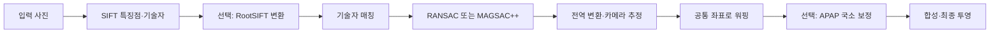

# 알고리즘과 구현 범위

## 처리 흐름

Q1은 두 영상 사이의 호모그래피를 구합니다. 다중 영상에서는 카메라 회전·초점거리를 추정하고 번들 조정(bundle adjustment, BA)과 수평 보정을 수행합니다. 이미지의 위치를 맞추는 기하 보정과, 겹친 부분의 밝기·경계를 다루는 합성은 별도 단계입니다.

## 다섯 방법

| CLI 이름 | 특징 기술자 | 강건 추정 | 국소 보정 | 다중 영상 BA |
| --- | --- | --- | --- | --- |
| `brown_lowe` | SIFT | RANSAC | 없음 | OpenCV ray BA |
| `rootsift` | RootSIFT | RANSAC | 없음 | NumPy ray BA |
| `magsac` | SIFT | MAGSAC++ | 없음 | NumPy ray BA |
| `rootsift_magsac` | RootSIFT | MAGSAC++ | 없음 | NumPy ray BA |
| `rootsift_magsac_apap` | RootSIFT | MAGSAC++ | APAP 계열 Moving DLT | NumPy ray BA |

RootSIFT는 SIFT 기술자를 L1 정규화한 뒤 제곱근을 취합니다. MAGSAC++ 방법은 후보 대응점에서 호모그래피와 인라이어를 다시 추정합니다. OpenCV 매처가 처음 구한 RANSAC 결과를 그대로 MAGSAC++ 결과라고 사용하지 않습니다.

APAP는 전역 정합 후 공통 투영 좌표에서 위치별 변환을 추정해 국소 오차를 줄입니다. 대응점이 부족한 곳과 영상 경계에서는 보정을 약하게 하고, 과도한 이동과 접힘을 제한합니다. 이 구현은 과제 조건에 맞춘 확장이며 APAP·BAMDLT 논문의 완전한 재현은 아닙니다.

기준 방법과 개선 방법은 다중 영상 BA 구현도 다릅니다. 따라서 Q2·Q3·E1·E2의 차이를 기술자나 강건 추정기의 효과만으로 해석할 수 없습니다. 외부 벤치마크의 Q1 경로에는 BA가 없습니다.

## 미션별 투영

- **Q1:** 한 영상을 기준으로 다른 영상을 평면에 워핑합니다.
- **Q2:** 영상 세 장을 공통 평면에서 합성한 뒤, 완성된 파노라마 전체를 하나의 원통 좌표계에 재투영합니다.
- **Q3:** 평면 합성 후 원통 재투영을 시도합니다. 시야가 평면의 투영 범위를 넘으면 같은 카메라 추정값으로 공통 원통에서 직접 합성합니다.
- **E1·E2:** 같은 방식으로 구면 투영을 사용합니다. 넓은 시야에서는 공통 구면에서 직접 합성합니다.

카메라 회전 모델은 같은 위치에서 방향을 바꾸며 촬영한 사진에 적합합니다. 큰 카메라 이동, 가까운 물체의 시차, 움직이는 피사체는 국소 보정으로도 완전히 해결되지 않을 수 있습니다.

## 후처리 조건

비교용 고정 코드와 `run_methods.py`는 `brown_lowe_assignment` 프로필을 사용합니다.

| 미션 | 합성 방식 |
| --- | --- |
| Q1·Q2·Q3·E1 | 원래 유효 마스크를 유지하고 나중 입력으로 덮어쓰기 |
| E2 | 영상별 gain 노출 보정 → 최대 가중치 소유 마스크 → 5단계 멀티밴드 블렌딩 |

이 프로필에서는 graph-cut 이음선 탐색과 블록 단위 노출 보정을 사용하지 않습니다. 후처리를 꺼도 기하 워핑과 재투영에 필요한 보간은 수행합니다. E2만 후처리하는 것은 이 비교 실험의 설정이며, 과제 공지의 모든 미션에 대한 일반적인 금지 조건은 아닙니다.

루트 `stitching.py`의 기본값은 `ALGORITHM="brown_lowe"`, `BASELINE_PROFILE=None`입니다. 직접 `run.py --code stitching.py`로 실행하면 위 비교 프로필과 후처리가 다를 수 있습니다. 특히 기본 Q1은 이음선 선택과 feather 합성을 사용합니다.

## 구현 파일

`stitching.py`는 개발용 소스이고 `experiments/snapshots/*.py`는 비교용 고정 버전입니다. 다섯 파일에는 설정 외의 구현 차이도 있으므로 하나를 다른 파일의 대체물로 취급하지 않습니다. 각 파일의 `q1`, `q2`, `q3`, `e1`, `e2`는 경로 목록을 받고 `uint8` 영상을 반환합니다. 파일 저장은 `run.py`가 담당합니다.

제출용 코드는 OpenCV와 NumPy만 import하며 별도 로컬 모듈이나 `cv2.Stitcher`에 의존하지 않습니다. 시각화 도구에서 사용하는 Matplotlib은 제출 알고리즘의 의존성이 아닙니다. 자세한 조건은 [과제 안내](assignment.md)를 참고하세요.
