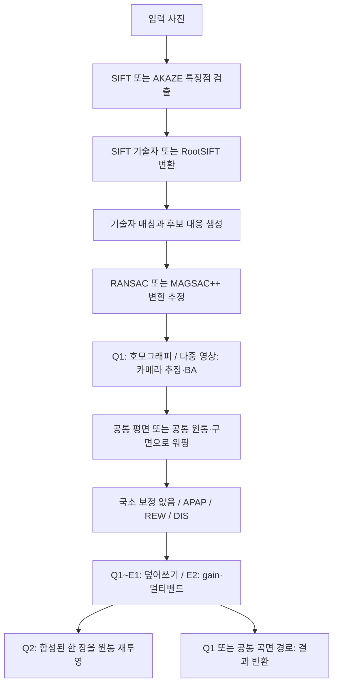

# 정합 알고리즘과 실험 방법론

## 처리 흐름과 방법론

### 단계별 실험 변인

| 단계 | 바꾼 변인 | 유지하거나 주의한 조건 |
| --- | --- | --- |
| 특징점 검출 | SIFT / AKAZE | 처리 해상도와 특징점 수 상한. 검출 위치뿐 아니라 스케일·방향도 달라짐 |
| 기술자 생성 | SIFT / RootSIFT | AKAZE 기본 MLDB 대신 검출 위치에서 SIFT를 계산; 실수 벡터·L2 거리 유지 |
| 특징점 매칭 | 별도 독립 변인으로 변경하지 않음 | 각 기술자에 동일한 매칭 절차 적용 |
| 강건 기하 추정 | RANSAC / MAGSAC++ | 선택된 인라이어를 후속 단계에 전달 |
| 카메라 최적화 | 조합 간 NumPy ray BA 고정 | B0만 OpenCV ray BA. Q1 및 외부 쌍에는 BA 없음 |
| 공통 좌표 워핑 | 미션에 따라 고정 | Q2 평면, 넓은 Q3 원통, 넓은 E1/E2 구면 |
| 국소 보정 | 없음 / APAP / REW / DIS | 알고리즘별 대응 정보·변형 모델·목표 좌표 차이 존재 |
| 합성·후처리 | 미션별로 고정 | E2만 gain·최대 가중치 마스크·멀티밴드 |
| 최종 재투영 | 미션별로 고정 | Q2는 완성된 평면 파노라마 전체에 한 번 적용 |

### SIFT·AKAZE·RootSIFT

SIFT는 특징점과 128차원 실수 기술자를 제공한다. AKAZE 조건에서는 검출 위치·스케일·방향을 AKAZE로 얻고 그 위치에서 SIFT 기술자를 계산한다. 따라서 실험 이름의 AKAZE는 **AKAZE 검출 + SIFT 계열 기술자**이며, AKAZE/MLDB 전체 파이프라인을 뜻하지 않는다. 서로 다른 octave 표현은 스케일에 맞게 변환한다. [실행 안내](../README.md)

RootSIFT는 SIFT 벡터를 L1 정규화한 뒤 각 성분의 제곱근을 취한다. 검출기를 바꾸는 방법이 아니라 기술자의 비교 특성을 바꾸는 방법이다. [Arandjelović·Zisserman, CVPR 2012](https://www.robots.ox.ac.uk/~vgg/publications/2012/Arandjelovic12/arandjelovic12.pdf)

### RANSAC·MAGSAC++

RANSAC은 후보 대응점 중 기하 모델과 일관된 인라이어를 찾는다. MAGSAC++ 조건은 OpenCV `USAC_MAGSAC`으로 변환과 인라이어를 다시 추정한다. 이번 구현도 최대 반복 수·신뢰도·오차 상한 등의 설정을 사용하므로 ‘모든 임계값이 없는 방법’이라고 설명하지 않는다. [Barath et al., CVPR 2020](https://openaccess.thecvf.com/content_CVPR_2020/papers/Barath_MAGSAC_a_Fast_Reliable_and_Accurate_Robust_Estimator_CVPR_2020_paper.pdf)

### APAP·REW·DIS

| 항목 | APAP 계열 | REW 기반 | DIS 기반 |
| --- | --- | --- | --- |
| 대응 정보 | 희소 특징점 대응 | 희소 특징점 대응과 잔차 | 영상 패치의 조밀한 대응 |
| 변형 | 위치별 가중 호모그래피 | TPS의 매끄러운 탄성 변형 | 위치별 2차원 이동 벡터 |
| 주요 계산 | Moving DLT | 정규화 TPS 선형계·계수 이상치 제거 | Dense Inverse Search 광류 |
| 다중 영상 정렬 목표 | 공통 track의 평균 위치 | APAP와 같은 공통 목표 | 마지막 영상 고정 후 역순 정렬 |
| 공통 안전 장치 | 변위 제한·경계 감쇠·접힘 방지 | 같은 제한에 TPS 정제 추가 | 왕복 검사·텍스처 신뢰도·평활화·접힘 방지 |
| 구현 해석 | 원 APAP/BAMDLT 전체 재현 아님 | 원 저자 전체 REW 파이프라인 재현 아님 | OpenCV DIS에 프로젝트용 후속 처리 추가 |

APAP는 가까운 대응점에 큰 가중치를 주는 Moving DLT로 전역 모델이 설명하지 못하는 차이를 보완한다. 이 프로젝트는 공통 투영 이후의 잔차 보정으로 적용했다. [APAP 원 논문](https://openaccess.thecvf.com/content_cvpr_2013/html/Zaragoza_As-Projective-As-Possible_Image_Stitching_2013_CVPR_paper.html)

REW 기반 구현은 TPS 커널 `0.5*r²*log(r²)`, 정규화 항, 3σ 계수 이상치 제거를 사용한다. 최대 512개 제어점, 64px 격자, 공통 좌표의 track 목표, 48px 이동 상한 등은 프로젝트의 적용 방식이다. 원 저자의 순차 파이프라인·좌표계와 차이가 있다. [REW 원 저자 코드](https://github.com/gain2217/Robust_Elastic_Warping)

DIS는 패치 대응의 역탐색, 여러 해상도에서의 조밀한 변위장 결합, 변분 정제를 수행하는 광류 방법이다. 프로젝트에서는 양방향 일치 검사와 변위 제한 등을 추가했다. [DIS 논문](https://arxiv.org/abs/1603.03590)

**비교 해석:** DIS는 대응 정보를 더 조밀하게 사용하는 것과 다중 영상의 정렬 기준을 바꾸는 효과가 함께 포함된다. APAP/REW 대비 차이를 단일 최적화 풀이기의 우열로만 해석할 수 없다. Q1과 외부 쌍에서는 기존 평가 좌표를 유지하도록 첫 영상을 고정한다.

## 실험 케이스 구성

### 33방법 구성

B0는 원래 OpenCV BA 참조이다. F00은 같은 검출기·기술자·RANSAC을 사용하되 조합 실험의 NumPy BA를 사용하는 통제 기준이다. 국소 보정의 효과는 F00/F01/R00/D00처럼 **나머지 세 변인이 같은 방법끼리** 비교한다.

| 코드 | 검출기 | 기술자 | 추정기 | 국소 보정 | 다중 영상 BA |
| --- | --- | --- | --- | --- | --- |
| B0 | SIFT | SIFT | RANSAC | 국소 보정 없음 | OpenCV ray BA |
| F00 | SIFT | SIFT | RANSAC | 국소 보정 없음 | NumPy ray BA |
| F01 | SIFT | SIFT | RANSAC | APAP 계열 | NumPy ray BA |
| F02 | SIFT | SIFT | MAGSAC++ | 국소 보정 없음 | NumPy ray BA |
| F03 | SIFT | SIFT | MAGSAC++ | APAP 계열 | NumPy ray BA |
| F04 | SIFT | RootSIFT | RANSAC | 국소 보정 없음 | NumPy ray BA |
| F05 | SIFT | RootSIFT | RANSAC | APAP 계열 | NumPy ray BA |
| F06 | SIFT | RootSIFT | MAGSAC++ | 국소 보정 없음 | NumPy ray BA |
| F07 | SIFT | RootSIFT | MAGSAC++ | APAP 계열 | NumPy ray BA |
| F08 | AKAZE | SIFT | RANSAC | 국소 보정 없음 | NumPy ray BA |
| F09 | AKAZE | SIFT | RANSAC | APAP 계열 | NumPy ray BA |
| F10 | AKAZE | SIFT | MAGSAC++ | 국소 보정 없음 | NumPy ray BA |
| F11 | AKAZE | SIFT | MAGSAC++ | APAP 계열 | NumPy ray BA |
| F12 | AKAZE | RootSIFT | RANSAC | 국소 보정 없음 | NumPy ray BA |
| F13 | AKAZE | RootSIFT | RANSAC | APAP 계열 | NumPy ray BA |
| F14 | AKAZE | RootSIFT | MAGSAC++ | 국소 보정 없음 | NumPy ray BA |
| F15 | AKAZE | RootSIFT | MAGSAC++ | APAP 계열 | NumPy ray BA |
| R00 | SIFT | SIFT | RANSAC | REW 기반 | NumPy ray BA |
| R01 | SIFT | SIFT | MAGSAC++ | REW 기반 | NumPy ray BA |
| R02 | SIFT | RootSIFT | RANSAC | REW 기반 | NumPy ray BA |
| R03 | SIFT | RootSIFT | MAGSAC++ | REW 기반 | NumPy ray BA |
| R04 | AKAZE | SIFT | RANSAC | REW 기반 | NumPy ray BA |
| R05 | AKAZE | SIFT | MAGSAC++ | REW 기반 | NumPy ray BA |
| R06 | AKAZE | RootSIFT | RANSAC | REW 기반 | NumPy ray BA |
| R07 | AKAZE | RootSIFT | MAGSAC++ | REW 기반 | NumPy ray BA |
| D00 | SIFT | SIFT | RANSAC | DIS 기반 | NumPy ray BA |
| D01 | SIFT | SIFT | MAGSAC++ | DIS 기반 | NumPy ray BA |
| D02 | SIFT | RootSIFT | RANSAC | DIS 기반 | NumPy ray BA |
| D03 | SIFT | RootSIFT | MAGSAC++ | DIS 기반 | NumPy ray BA |
| D04 | AKAZE | SIFT | RANSAC | DIS 기반 | NumPy ray BA |
| D05 | AKAZE | SIFT | MAGSAC++ | DIS 기반 | NumPy ray BA |
| D06 | AKAZE | RootSIFT | RANSAC | DIS 기반 | NumPy ray BA |
| D07 | AKAZE | RootSIFT | MAGSAC++ | DIS 기반 | NumPy ray BA |

## 측정 당시 환경과 주요 설정

| 항목 | 기록된 설정 |
| --- | --- |
| Python / OpenCV / NumPy | 3.10.12 / 4.5.4 / 1.26.4 |
| OpenCV·BLAS 스레드 | OpenCV 1, OPENBLAS_NUM_THREADS=1, OMP_NUM_THREADS=1 |
| 특징점 처리 해상도·상한 | 최대 1.0MP, 특징점 상한 6,000 |
| AKAZE 초기 임계값 | 0.001, 특징점 상한 초과 시 단계적 조정 |
| APAP/REW 격자·이동 상한 | 64px / 48px, 공통 투영 좌표 기준 |
| REW | 정규화 계수 0.001, 최대 제어점 512, 최대 정제 10회 |
| DIS | MEDIUM, finest scale 0, 광류 영상 긴 변 최대 1,400px |
| DIS 신뢰도·안전 조건 | 왕복 오차 2px 이하(광류 해상도), 변위 48px 이하(공통 투영 좌표), 최소 Jacobian 0.2 |
| 난수 | 각 정합 시작 시 OpenCV seed 0 |
| 외부 병렬 작업자 | 4개 프로세스; 평가 중 종료 후 동일 조건으로 재개 |
| 속도 비교 | 특징점·매칭 재사용으로 방법별 실행 시간은 독립적인 속도 지표로 사용하지 않음 |

원본 사진은 Q1 2장, Q2 3장, Q3 8장으로 총 13장이다. E1/E2는 Q3의 사진을 재사용한다. 한 방법의 미션 평가에는 2+3+8+8+8=29개의 원본–결과 비교가 있으며, 최종 33방법에서는 957개 비교 기록이 생성된다.

현재 루트 코드의 일반 실행과 비교 프로필은 구분한다. 루트 기본 Q2는 DIS가 켜져 있지만, 기존 none/APAP/REW 비교 프로필에서는 자동 DIS를 끈다. 이번 D00~D07은 `ALGORITHM` 끝에 `_dis`를 명시해 Q1~E2 모두에서 DIS를 실행한다. 현재 재현은 `stitching.py`의 내장 케이스 구성을 사용한다. 과거 스냅샷은 정리 과정에서 삭제했으며 기록된 점수는 결과 문서에 보존한다.

## 현재 실행 구조

`python stitching.py`는 33케이스 × 다섯 미션을 실행한다. 출력 경로는 `results/<방법>/<전체 케이스 ID>/<미션>_result.png`이다. 방법 폴더는 `brown_lowe`, `global`, `apap`, `rew`, `dis`이며 `global`은 국소 보정 없는 8조합이다. `--task list`로 전체 ID를 확인한다.

`q1(img_paths)`부터 `e2(img_paths)`까지의 제출 함수는 파일을 저장하지 않고 BGR uint8 배열만 반환한다. 직접 실행용 CLI가 이미지 저장과 평가를 담당한다. `run.py`는 제공 파일 그대로 유지한다. CLI와 평가 보조 기능도 같은 파일 안에 있으며 직접 만든 다른 Python 파일을 import하지 않는다.

방법 선택·벤치마크 다운로드·평가 명령은 [README](../README.md), 지표 해석은 [벤치마크와 지표](benchmarks.md)를 참고한다.

## 고신뢰 매칭의 자동 제외 방지

다중 영상 매처의 `PAIR_CLOSE_CONFIDENCE_LIMIT`를 3.5로 명시한다. OpenCV의 기본 매처는 `인라이어 수 / (8 + 0.3 × 후보 수)`가 기본 상한 3을 넘으면 너무 유사한 영상 쌍으로 보고 신뢰도를 0으로 만든다. OpenCV 버전에 따른 매칭 결과 차이로 Q3의 유일한 연결이 이 규칙에 걸릴 수 있었다. 이 프로젝트는 주어진 입력을 모두 포함해야 하므로, 이론적 신뢰도 상한 10/3보다 큰 3.5를 사용해 고신뢰 연결의 자동 제외를 비활성화한다.

상한 인자를 지원하는 버전에서는 매처 생성 시 설정한다. OpenCV 4.5.4처럼 인자를 지원하지 않는 버전에서는 기본 매처 결과 중 신뢰도가 0이고 원래 계산값이 3 초과인 쌍만 복구한다. 이때 최소 인라이어 수와 유한한 비특이 호모그래피를 확인한다. 낮은 신뢰도의 매칭은 복구하지 않으며, 그래프 연결 검사 기준(`MIN_INLIERS=10`, 신뢰도 하한 1.0)은 유지한다.

이 수정은 매칭 연결 정책의 변경이다. 기존 결과 문서의 측정값은 수정 전 환경·설정의 기록이며, 새 결과 PNG를 생성했다고 해서 그 점수가 자동으로 다시 계산되는 것은 아니다. [OpenCV 매처 구현](https://github.com/opencv/opencv/blob/4.14.0/modules/stitching/src/matchers.cpp)
